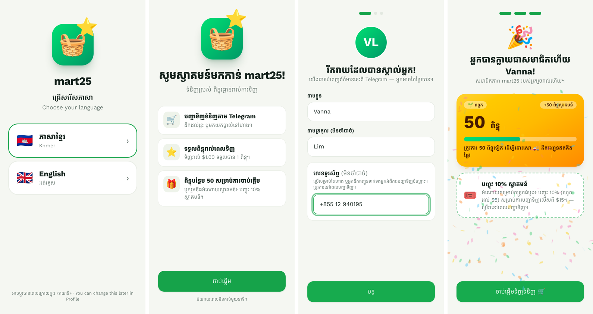
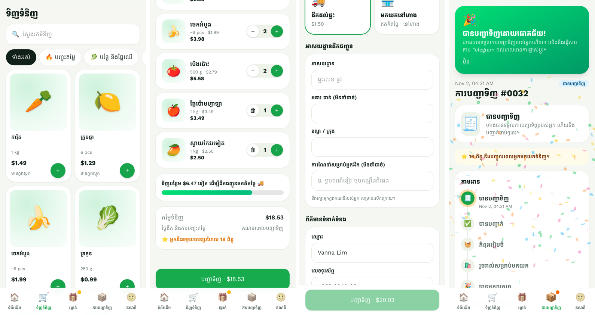
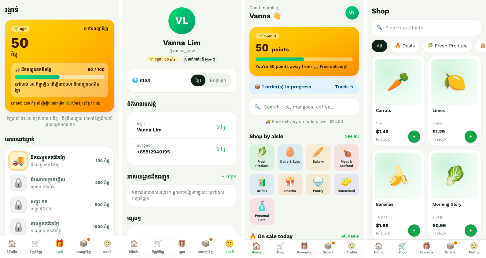
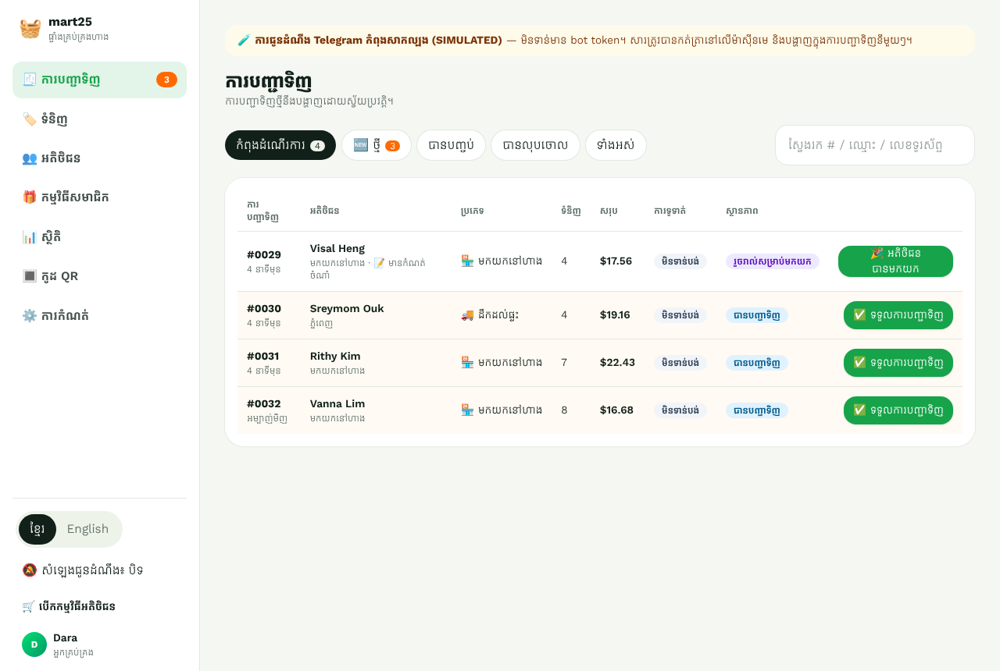
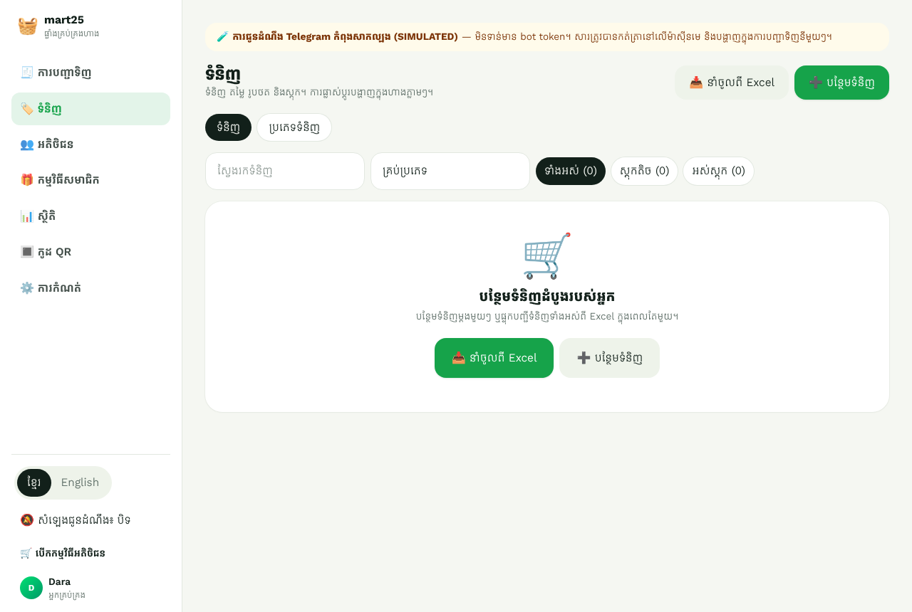
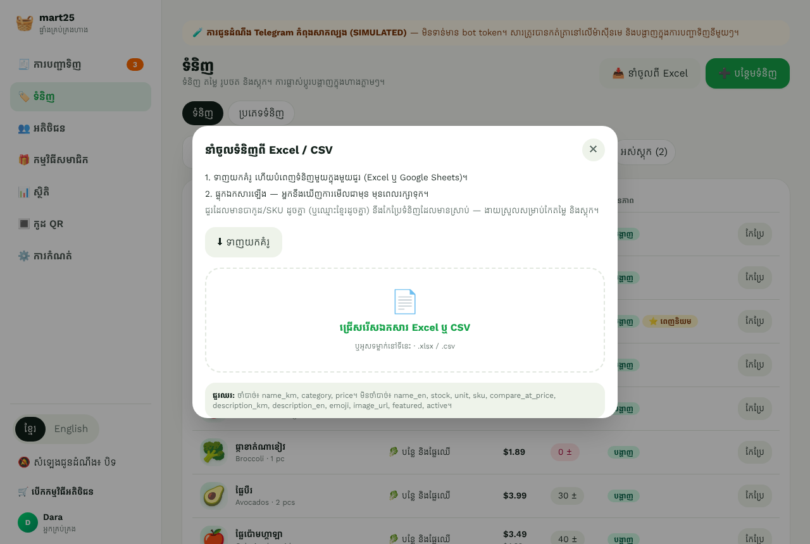

# mart25: Telegram Mini App (ខ្មែរ / English)

A Telegram Mini App for the **mart25** supermarket. It has three parts:

- **Customer shopping app:** QR-code entry, short onboarding with a **Khmer or English** language choice, catalog, cart, delivery or pickup, **cash payment**, and order tracking.
- **Loyalty game:** points, levels, milestone rewards, a welcome gift, badges and celebrations.
- **Seller dashboard:** live orders, catalog and stock, loyalty setup, customers, insights and printable bilingual QR posters.

> Product summary, journeys, architecture, database design and roadmap: **[docs/PLAN.md](docs/PLAN.md)**.
> Going live step by step: **[docs/DEPLOY.md](docs/DEPLOY.md)**.

| First visit (Khmer) | Shop → basket → checkout → order |
| --- | --- |
|  |  |

| Rewards, profile & English mode | Dashboard (Khmer) |
| --- | --- |
|  |  |

## Languages

- On the **first screen** a new customer picks **ភាសាខ្មែរ** or **English**. The choice is saved on their account and can be changed any time in **Profile → Language**. Staff get the same switch in the dashboard.
- Everything follows the chosen language:
  - every screen
  - error, stock and coupon messages from the server
  - **Telegram bot messages** (each person gets messages in their own language)
  - Khmer dates (e.g. *2 វិច្ឆិកា, 04:31*)
- **Shop data is bilingual.** Products, aisles, rewards, coupons, levels and the tagline each have a Khmer field and an **optional English field**. English customers see the English text when it exists, otherwise the Khmer one. The staff picking list shows the Khmer product name.
- The Khmer font (**Kantumruy Pro**) ships with the app, and line spacing is tuned for Khmer script.
- Translations live in `web/src/i18n/` (app) and `server/src/lib/i18n.ts` (server and bot messages). Khmer is the default (`DEFAULT_LANGUAGE=km`).

## Payments

**Cash only for now:** cash on delivery, or pay at the counter for pickup. Orders reach the shop immediately, and staff tap **"បានទទួលប្រាក់" (Mark paid)** when the money is collected. Payment status is tracked separately from the order's progress.

Online / QR payment (e.g. ABA) was removed for now. A complete QR flow is preserved in the git history (commit `4c24b89`):

- hold stock while unpaid
- release the order to the shop when payment is confirmed
- auto-cancel unpaid orders
- an ABA PayWay provider placeholder

The database still has the related columns, so it can be brought back without a data migration.

## Stack

| Layer | Choice |
| --- | --- |
| Mini App and dashboard | React 19, Vite, TypeScript, Tailwind 4, TanStack Query (one code-split SPA) |
| API | Node 22, Fastify 5, zod, JWT. Prices, discounts and points are computed on the server |
| Database | PostgreSQL 16 with Drizzle ORM. Transactions, row locks, unique, partial and CHECK constraints |
| Bot | Telegram Bot API (webhook in production, polling in dev). Notifications use an outbox table |

## Quick start (local, no Telegram needed)

Prerequisites: **Node 22+**, and **PostgreSQL 16** (or Docker).

```bash
cp .env.example .env
```

```bash
docker compose up -d db
```

```bash
npm install
```

```bash
npm run db:migrate && npm run db:seed
```

```bash
npm run dev
```

Open **http://localhost:5173**. Outside Telegram you get a **DEV MODE** login screen (off in production):

- **✨ New customer:** full first visit, starting with the language picker. Add `?src=store` to simulate the in-store QR.
- **👩 Sophea:** returning customer with points and orders.
- **🧑‍💼 Dara:** shop admin. Opens the dashboard at `/admin`.

`npm run db:reset` re-seeds the demo: a Khmer/English catalog of 54 products (jasmine rice, morning glory, Keo Romeat mangoes and more), 6 customers, about 30 orders, coupons and milestones. For production, `npm run db:seed:starter` (or `SEED_ON_START=starter`) creates only the settings, levels, rewards and aisles.

## Tests

```bash
createdb -O market market_test
```

```bash
npm test
```

There are 36 tests: unit tests for Telegram signatures and pricing, plus API integration tests against real Postgres. They cover:

- onboarding and privacy consent
- one welcome gift per account and per phone
- idempotent checkout
- concurrent purchases never overselling
- single-use rewards
- points awarded once on completion and reversed once on refund
- cancellations
- role-based access
- cash only
- **Khmer/English responses and per-customer Telegram message language**

## Running it in Telegram / production

See **[docs/DEPLOY.md](docs/DEPLOY.md)**. In short:

1. Create a bot with @BotFather.
2. Deploy with `render.yaml` (Render Blueprint, Singapore).
3. Enable the Mini App in BotFather with your Render URL.
4. Open the bot and tap **🛒 ទិញទំនិញ**. Staff send `/dashboard`.

Telegram notifications are real when `TELEGRAM_BOT_TOKEN` is set. Without it they're clearly marked **SIMULATED** (logged and shown on each order).

## Adding products

The catalog starts empty. **Dashboard → ទំនិញ (Catalog)** has two buttons:

- **➕ បន្ថែមទំនិញ (Add product):** one product at a time, with photo upload.
- **📥 នាំចូលពី Excel (Import from Excel):** download the template, fill it in Excel or Google Sheets, then upload the `.xlsx` or `.csv`. You see a preview (new, update, error) before anything is saved. Re-uploading updates products by barcode/SKU, or by Khmer name if there's no barcode, so it also works for bulk price and stock changes.

Column reference: [docs/DEPLOY.md → Adding products from Excel](docs/DEPLOY.md#adding-products-from-excel).

| Empty catalog | Import from Excel |
| --- | --- |
|  |  |

## QR codes

**Dashboard → កូដ QR** gives ready-made codes for the store poster, receipts and flyers, plus custom tags. Each has a PNG download and a printable **bilingual poster** (Khmer and English). Links look like `https://t.me/<bot>?startapp=store`. The tag is saved as the customer's sign-up source and shown in Insights.

## Security notes

- Telegram `initData` and shared contacts are verified with HMAC-SHA256 on the server.
- Short-lived JWTs. The role is re-read from the database on every request.
- Roles:
  - **customer**
  - **staff:** orders, catalog, customers (read-only), insights, QR
  - **admin:** everything, including loyalty, settings, roles and point adjustments
- Rate limits are per account. Security headers and CSP allow Telegram Web's iframe.

## Project layout

```
server/src
  lib/i18n.ts        server & bot translations (km/en), request language, per-recipient language
  routes/            public (auth, onboarding, catalog), customer, telegram, admin/*
  services/          checkout, orders, loyalty, notifications, identity, bot, pricing, productImport
  db/                schema.ts, migrate, seed (starter + demo), reset
server/test          unit + integration tests
web/src
  i18n/              en.ts, km.ts (customer) · en-admin.ts, km-admin.ts (dashboard)
  pages/onboarding   splash, dev login, language → welcome → about → privacy → celebration
  pages/customer     home, shop, product, cart, checkout, orders, tracking, rewards, profile
  pages/admin        orders, catalog (+ Excel/CSV import), customers, loyalty, insights, QR codes, settings
docs/                PLAN.md, DEPLOY.md, screenshots
```

## Simulated / development-only (labelled in the UI)

- **Dev login** (development only).
- **Telegram notifications** are simulated when no bot token is set.
- **Tracking** is status updates from staff. GPS tracking is a future feature.
