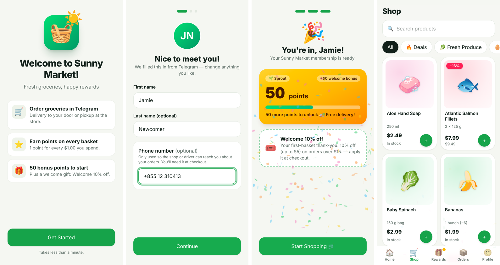
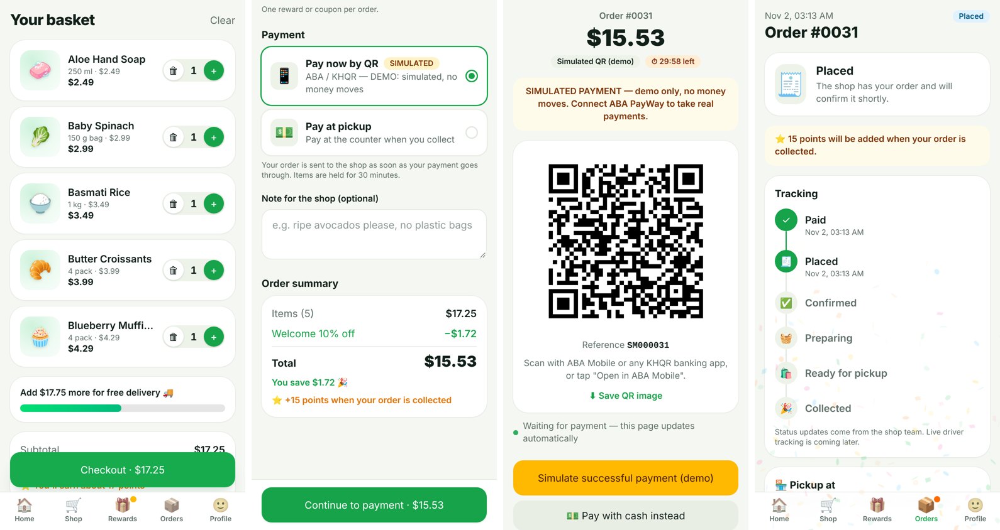
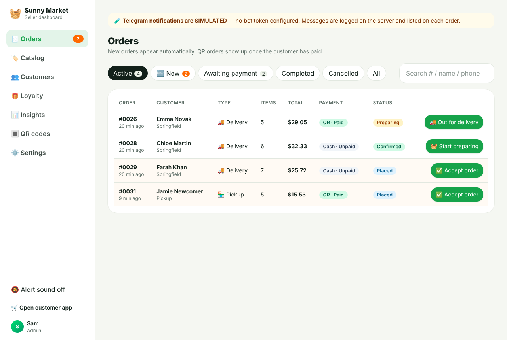
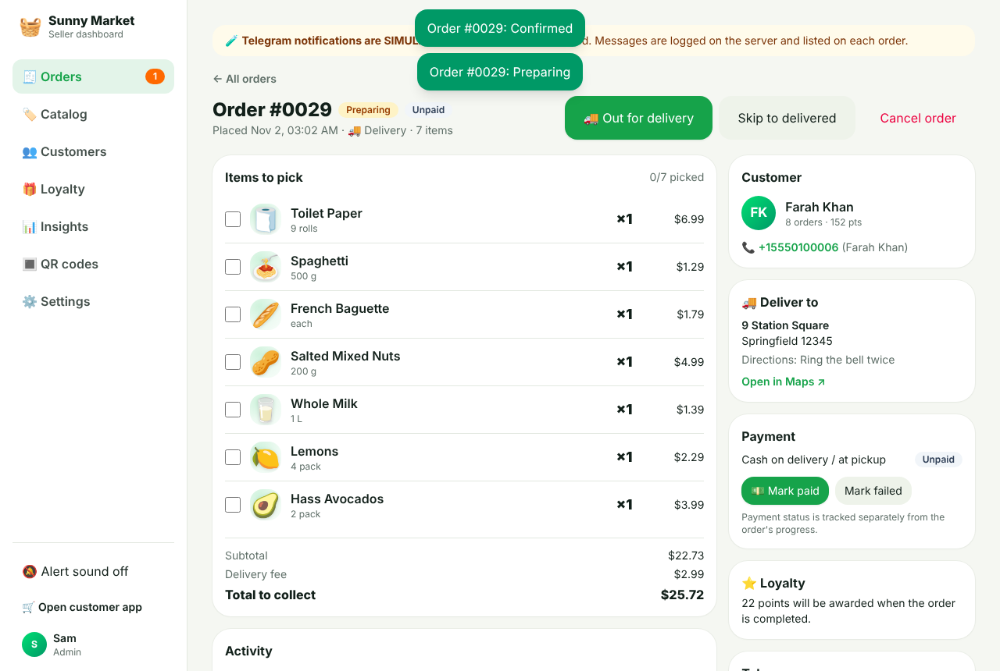
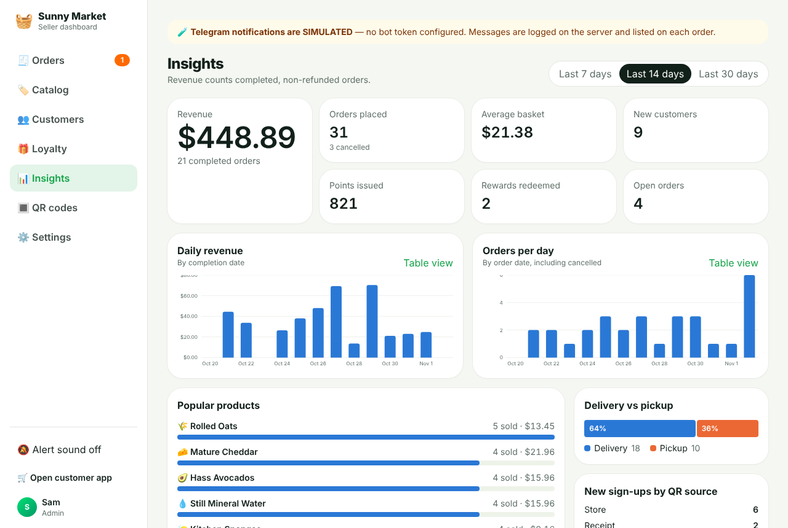

# Sunny Market: Telegram Mini App for a supermarket

A Telegram Mini App for a physical supermarket. It has three parts:

- **Customer shopping app:** QR-code entry, short onboarding, catalog, cart, delivery or pickup, cash or QR payment, and order tracking.
- **Loyalty game:** points, levels, milestone rewards, a welcome gift, badges and celebrations.
- **Seller dashboard:** live orders, catalog and stock, loyalty setup, customers, insights and printable QR codes.

> Product summary, journeys, architecture, database design and the phased roadmap are in **[docs/PLAN.md](docs/PLAN.md)**.

| Customer onboarding (QR first visit) | Checkout → QR payment → tracking |
| --- | --- |
|  |  |

| Seller dashboard: orders | Order detail | Insights |
| --- | --- | --- |
|  |  |  |

## Stack

| Layer | Choice | Why |
| --- | --- | --- |
| Mini App and dashboard | React 19, Vite, TypeScript, Tailwind 4, TanStack Query | One code-split SPA: customers never download dashboard code. Telegram's official `telegram-web-app.js` handles theme, haptics, BackButton and `requestContact`. |
| API | Node 22, Fastify 5, zod, JWT | Fast and small. All validation, pricing, discounts and points are computed on the server. |
| Database | PostgreSQL 16 with Drizzle ORM | Transactions, row locks, unique, partial and CHECK constraints enforce stock, idempotency and once-only rewards in the database. |
| Bot | Telegram Bot API over `fetch` | Webhook in production, long-polling in dev. Notifications go through an **outbox table**, so a Telegram outage never blocks an order. |

The API serves the built SPA, so you deploy **one service plus Postgres**.

## Quick start (local, no Telegram needed)

Prerequisites: **Node 22+**, and **PostgreSQL 16** (or Docker).

```bash
cp .env.example .env
```

```bash
docker compose up -d db
```

```bash
npm install
```

```bash
npm run db:migrate && npm run db:seed
```

```bash
npm run dev
```

Open **http://localhost:5173**. Outside Telegram you get a **DEV MODE** login screen (`DEV_LOGIN_ENABLED=true`, always off in production):

- **✨ New customer (QR first visit)** walks through the full onboarding. Add `?src=store` to the URL to simulate the in-store QR.
- **👩 Alice** is a returning customer with points and order history.
- **🧑‍💼 Sam** is the shop admin and opens the dashboard at `/admin`.

Open the dashboard in one window and the customer app in another (private window). Place an order as a customer and watch it arrive in the dashboard with a toast, an optional sound and a badge. Move it to *Delivered*/*Collected* and the customer's points and milestones update.

`npm run db:reset` drops everything and re-seeds 53 products, 6 customers, about 30 orders, coupons and milestones.

## Tests

```bash
createdb -O market market_test
```

```bash
npm test
```

There are 38 tests: unit tests for Telegram signature checks and pricing, plus **API integration tests against real Postgres**. They cover:

- forged or expired `initData`
- privacy consent before the account exists
- double-submitted onboarding
- one welcome gift per account and per phone
- verified contact sharing
- idempotent checkout
- **concurrent purchases never overselling**
- single-use rewards under concurrency
- per-customer coupon limits
- points awarded once, only on completion, and reversed once on refund
- milestone revocation after a refund
- cancellation restoring stock and rewards
- QR orders hidden from the shop until paid
- payment-window expiry releasing stock
- role-based access

Set `TEST_DATABASE_URL` to use a different database.

## Running it inside Telegram

1. **Create a bot** with [@BotFather](https://t.me/BotFather) (`/newbot`). Put the token in `TELEGRAM_BOT_TOKEN` and the username in `TELEGRAM_BOT_USERNAME`.
2. **Get an HTTPS URL.** Telegram only opens HTTPS Mini Apps. In dev, tunnel the Vite port, which proxies `/api`:

   ```bash
   cloudflared tunnel --url http://localhost:5173
   ```

   Set `PUBLIC_URL` to the tunnel URL.
3. **Register the Mini App** in BotFather: *Bot Settings → Configure Mini App* (the bot's main Mini App) and/or `/newapp` to get a short name (`TELEGRAM_MINIAPP_SHORT_NAME`). Use your `PUBLIC_URL` as the URL.
4. Set `TELEGRAM_BOT_MODE=polling` (dev) and your own Telegram user ID in `ADMIN_TELEGRAM_IDS`. You can get your ID from [@userinfobot](https://t.me/userinfobot).
5. Restart `npm run dev`. The bot sets its menu button and commands: `/shop`, `/orders`, `/rewards`, `/dashboard` (staff only; also sends a one-time browser login link valid for 10 minutes).

Notifications are **real** when a bot token is set. Otherwise they're **SIMULATED**: logged on the server, stored with status `simulated`, and shown on each order in the dashboard. Customers only receive bot messages after they've opened the bot or allowed messages.

## QR codes (store and receipts)

Go to **Dashboard → QR codes** for ready-made codes (`store`, `receipt`, `flyer`, or any custom tag). Each has a PNG download and a printable poster. The links look like this:

```
https://t.me/<bot>/<short_name>?startapp=store     # with TELEGRAM_MINIAPP_SHORT_NAME
https://t.me/<bot>?startapp=store                  # bot's main Mini App
```

The `startapp` tag arrives signed inside `initData`. It's saved as the customer's sign-up source and shown in Insights.

## First-time customer flow

**Scan QR → splash (initData verified server-side) → returning customer goes straight to Home**, or a **new customer** sees:

1. Welcome screen with **Get Started**.
2. Name (prefilled from Telegram), photo, and an optional phone number via **Telegram's contact sheet** (signed by Telegram and verified on the server) or typed manually. The phone is never assumed.
3. Short privacy notice and an *I agree* checkbox. **Only now is the account created.** The signup bonus and welcome coupon are granted once, in one transaction.
4. Celebration screen showing points, the first milestone and the welcome coupon, then **Start Shopping**.

Duplicate accounts and repeated welcome rewards are blocked by unique indexes on the Telegram ID, on `welcome_grants.user_id` and `welcome_grants.phone_key`, and by a partial unique index (one welcome coupon per customer). Customers can edit their name, phone and addresses later in Profile.

## Payments

Payment status (`unpaid / paid / refunded / failed`) is **separate** from fulfilment status.

- **Cash on delivery / at pickup:** the order goes to the shop immediately. Staff mark it *Paid* when they collect the money.
- **Pay now by QR:** the order is created as **Awaiting payment** and the stock is reserved, but **the shop isn't alerted and doesn't see it as a new order**. The customer gets a payment screen with the QR, amount, reference, countdown and an *Open in ABA Mobile* deep link. Once the payment is confirmed, the order becomes **Placed**, staff get the new-order alert, and the customer gets a message. Unpaid orders are cancelled after `paymentWindowMinutes` (default 30) and the stock is released. Customers can also switch to cash or cancel.

QR providers (Dashboard → Settings → Payments):

| Mode | Status |
| --- | --- |
| **Simulated** | **DEMO ONLY, clearly labelled.** Scanning the QR opens a "simulated payment" page, or use the in-app button. No money moves. Automatically disabled in production (`ALLOW_SIMULATED_PAYMENTS`). |
| **ABA PayWay** | **Placeholder, ready for your ABA API.** See below. |

### Connecting ABA PayWay

Everything around the payment is already built: holding stock, the payment screen, sending the order to the shop once paid, expiry, and notifications. The only file to fill in is **`server/src/services/providers/aba-payway.ts`**:

1. Add `ABA_PAYWAY_MERCHANT_ID`, `ABA_PAYWAY_API_KEY` and `ABA_PAYWAY_BASE_URL` (sandbox first) to `.env`.
2. `createCharge()`: call ABA's QR/purchase API with `reference` as the transaction id, the amount and currency, and `callbackUrl`. Return `{ qrPayload, appLink }`.
3. `handleCallback()`: verify ABA's callback (or re-check the transaction with ABA) and return `{ orderReference, paid }`. The route `POST /api/payments/aba_payway/callback` then calls `confirmQrPayment()`, which is idempotent.
4. Make `isConfigured()` return `true` and select **ABA PayWay** in Settings.

## Deploying

> **Step-by-step production guide (Telegram bot, Render, first login, shop setup, QR posters): [docs/DEPLOY.md](docs/DEPLOY.md).**
> `render.yaml` deploys the app and Postgres to Render (Singapore) as a Blueprint. On first boot `SEED_ON_START=starter` creates the shop settings, levels, rewards and aisles, with no demo data.

The app is a single Docker image (or plain Node service) plus managed Postgres. It works on Render, Railway, Fly.io or a VPS.

```bash
docker compose --profile app up --build
```

That runs a production-like stack locally on http://localhost:3000.

Production checklist:

- `NODE_ENV=production`, a long random `SESSION_SECRET` (`openssl rand -hex 32`), and `DATABASE_URL` (plus `DATABASE_SSL=true` for most managed Postgres).
- `PUBLIC_URL=https://your-domain`, `TELEGRAM_BOT_MODE=webhook`, and a random `TELEGRAM_WEBHOOK_SECRET`. The webhook is registered on boot.
- `MIGRATE_ON_START=true` (or run `node dist/db/migrate.js` as a release step).
- Update the Mini App URL in BotFather to your domain.
- **Uploads:** product photos are stored on local disk (`server/uploads`). Mount a persistent volume, or swap in S3/R2 for multi-instance deploys.
- Starter data (settings, levels, rewards, aisles): `SEED_ON_START=starter` or `npm run db:seed:starter`. Demo data for testing only: `node dist/db/seed.js`.
- Run a **single instance** for the MVP (the notification and expiry workers are in-process). Move them to a job queue before scaling out.

## Security notes

- `initData` and shared contacts are verified with HMAC-SHA256 (constant-time compare, max age). Unpaid QR links use unguessable tokens.
- Short-lived JWTs: an onboarding token holds only the verified Telegram identity, and the session role is re-read from the database on every request.
- Roles:
  - **customer**
  - **staff:** orders, catalog, customers (read-only), insights, QR
  - **admin:** everything, including loyalty, settings, roles and manual point adjustments
- Rate limits are per account (or per IP before sign-in). Helmet security headers and CSP allow Telegram Web's iframe. Upload type is checked by magic bytes.

## Project layout

```
server/src
  routes/            public (auth, onboarding, catalog), customer, payments, telegram, admin/*
  services/          checkout, orders, loyalty, payments (+ providers/), notifications, identity, bot, pricing
  db/                schema.ts (all tables & constraints), migrate, seed, reset
server/test          unit + integration tests
web/src
  pages/onboarding   splash, dev login, 4-step onboarding
  pages/customer     home, shop, product, cart, checkout, pay, orders, tracking, rewards, profile
  pages/admin        orders, catalog, customers, loyalty, insights, QR codes, settings
docs/PLAN.md         product & technical plan, DB design, roadmap, future game features
```

## What's simulated or a placeholder (clearly labelled in the UI)

- **Simulated QR payments** (dev only) and the **ABA PayWay** placeholder.
- **Telegram notifications** are simulated when no bot token is set.
- **Dev login** (dev only).
- **Tracking** is status updates entered by staff. Live GPS is a future feature.
